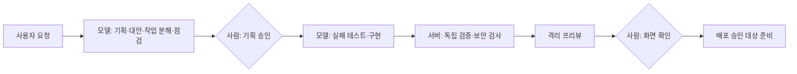

# 개발 사무실 · SKALA AI Mini Project

**요청 한 줄에서 시작하는 로컬 모델 개발 워크플로.**

로컬 모델이 기획·작업 분해·테스트·구현을 수행하고, 서버가 도구 실행 결과를 검증하며, 사람이 기획·화면 확인·배포를 승인하는 서비스입니다. 실행 하나를 사무실 건물로, Sprint를 층으로, 작업을 사람으로 표현합니다.

> **현재 상태 · 2026-10-22**
> 서비스의 전체 흐름은 가짜 모델을 사용한 통합 테스트와 합성 시연으로 확인했습니다. 실제 `qwen3.5:4b` 실행은 기획 승인과 빌더 시작까지 도달했으며, 앱 구현·검증·프리뷰까지의 완주는 확인하지 못했습니다. 실제 배포와 생성 앱의 원격 push는 비활성입니다.

## 동작 방식



- **빈 프로젝트에서 시작**: `blank-v1`은 앱 기능 코드를 제공하지 않습니다. 생성할 앱의 코드는 로컬 모델이 작성합니다.
- **구조화된 기획**: 대안, 작업 의존성, 쓰기 범위, 인수 기준(AC)별 자동 점검과 사람 확인 항목을 검증합니다.
- **TDD 게이트**: 실제 실패 테스트를 확인한 뒤 구현을 허용합니다. 모델의 성공 선언만으로 통과시키지 않습니다.
- **독립 검증**: 승인된 점검 명세를 고정된 후보 커밋·이미지에서 실행하고, 검증과 보안의 판정을 별도로 기록합니다.
- **격리와 원장**: Docker의 네트워크·권한·자원 제한 아래 도구를 실행하며, 호출·결과·실패와 감지한 작업 공간 개입을 기록합니다.
- **승인 경계**: 승인 대상은 명세·후보에 결속됩니다. 변경 요청은 재기획으로 보내고 이전 승인을 무효화합니다. 사람 확인 승인도 자동 점검의 `not_run`을 `met`으로 바꾸지 않습니다.
- **사건 기반 화면**: 서버가 제공한 상태와 공개 사건으로 장면을 구성합니다. 근거 없는 진행률이나 남은 시간은 표시하지 않습니다.

## 기술 구성

| 영역 | 구성과 역할 |
|---|---|
| 사무실 화면 | Vue 3 · TypeScript · Vite, SSE로 상태·사건 수신 |
| API | FastAPI, 로컬 세션·CSRF 검증, JSON Schema 계약 |
| 실행기 | Python · LangGraph · MCP, 기획·빌더·검토 작업 실행 |
| 영속 기록 | SQLite, 요청·명세·승인·작업·시도·도구·모델 응답 보존 |
| 추론 | Ollama `qwen3.5:4b`, 추론 슬롯 1개 |
| 격리·보안 | Docker, 승인된 점검 실행, 정적 검사와 Grype 이미지 취약점 검사 |

API와 worker는 별도 프로세스이며 같은 DB를 사용합니다. worker는 lease와 heartbeat로 중복 실행을 제어합니다. 프론트엔드는 LIVE·실제 기록 재생·합성 예시를 구분해서 표시합니다.

## 먼저 화면만 보기

합성 시연에는 Ollama·Docker·백엔드가 필요하지 않습니다. Node.js 22.12 이상과 npm을 준비하고 저장소 루트에서 실행합니다. 확인 환경은 Node.js 26.5입니다.

```sh
cd frontend
npm ci
npm run dev
```

브라우저에서 **[5층 전체 과정 합성 시연](http://127.0.0.1:5173/?example=full-cycle)**을 엽니다.

기획 → 기획 승인 → 층별 구현 → 독립 검토 → 프리뷰 확인 → 배포 승인 대상 순서로 진행합니다. 기획 승인과 사람 확인에서 멈추므로 화면의 승인 버튼을 눌러야 이어집니다. 왼쪽 아래 `다음 단계` 또는 `N` 키로 사건을 빠르게 넘길 수 있습니다.

합성 시연은 서버로 명령을 보내지 않으며 실제 모델 실행 결과가 아닙니다. 합성 프리뷰에는 생성 앱 주소가 없습니다. 자세한 조작은 [사무실 사용법](docs/demo/office-usage.md)과 [시연 스크립트](docs/demo/demo-script.md)를 참고하세요.

## 로컬 모델과 함께 실행

### 1. 의존성 설치

Python 3.11 이상, Node.js, Git, Docker Desktop, Ollama가 필요합니다. 아래 명령은 저장소 루트 기준입니다. 확인 환경은 macOS arm64 · Python 3.14.7 · Node.js 26.5입니다.

```sh
python3 -m venv backend/.venv
backend/.venv/bin/python -m pip install -r backend/requirements.lock
npm ci --prefix frontend
```

### 2. 모델·격리 이미지·스캐너 준비

Docker Desktop과 로컬 Ollama를 먼저 실행합니다. 모델과 이미지는 운영자가 명시적으로 준비하며, 서비스가 자동으로 다운로드하거나 유료 API로 전환하지 않습니다.

```sh
ollama pull qwen3.5:4b
docker pull python:3.11-alpine
docker pull python:3.13-slim
docker pull node:24-slim
docker pull anchore/grype:v0.121.0
backend/.venv/bin/python -m runner.sandbox prepare
backend/.venv/bin/python -m runner.review prepare-scanner
```

Ollama를 직접 시작한다면 별도 터미널에서 다음 설정을 사용합니다. 이미 실행 중이면 두 번째 서버를 띄우지 않습니다.

```sh
OLLAMA_NO_CLOUD=1 OLLAMA_NUM_PARALLEL=1 OLLAMA_MAX_LOADED_MODELS=1 ollama serve
```

16GB 장비에서는 모델 실행 전에 **여유 메모리 40% 이상·스왑 2GB 미만**을 확인합니다. 메모리 감시 기준과 운영상 주의점은 [메모리 사고 기록](docs/reports/memory-incident-20261021.md), 이미지 준비와 격리 조건은 [Infra 안내](infra/README.md)에 있습니다.

### 3. API·worker·프론트 실행

API와 worker를 실행할 **두 터미널 모두** 저장소 루트에서 아래 환경을 설정합니다. Python·Node 이미지는 실제로 내려받은 digest에 고정합니다.

```sh
export LIFECYCLE_MODEL=qwen3.5:4b
export LIFECYCLE_DB=runtime-data/lifecycle.sqlite3
export LIFECYCLE_PYTHON_IMAGE="$(docker image inspect python:3.13-slim --format '{{index .RepoDigests 0}}')"
export LIFECYCLE_NODE_IMAGE="$(docker image inspect node:24-slim --format '{{index .RepoDigests 0}}')"
```

각 프로세스는 **서로 다른 터미널**에서 실행합니다.

| 터미널 | 저장소 루트에서 실행할 명령 | 주소·역할 |
|---|---|---|
| API | `backend/.venv/bin/python -m backend` | `http://127.0.0.1:8000` |
| worker | `backend/.venv/bin/python -m runner.worker` | 같은 DB의 작업 실행 |
| 프론트 | `npm run dev --prefix frontend` | `http://127.0.0.1:5173` |

`http://127.0.0.1:5173`을 열고 요청을 입력합니다. 기획과 사람 확인은 사용자가 화면에서 직접 승인합니다. API·worker·모델이 준비되지 않으면 LIVE 실행을 시작할 수 없습니다. 실행 이미지를 변경한 뒤에는 격리 이미지를 다시 준비해야 할 수 있습니다.

선택 사항인 로컬 임베딩, 환경변수, 기록 내보내기·가져오기 등은 [백엔드 실행 안내](backend/README.md)를 참고하세요. 실제 기록 재생은 API가 필요하지만 worker·모델·Docker 없이 열람할 수 있습니다.

## 검증 결과와 남은 일

합성 시연, 서비스 테스트, 실제 모델 실험은 서로 다른 근거입니다.

| 확인 범위 | 결과 |
|---|---|
| 가짜 모델 통합 테스트 | 기획·승인·빌드·독립 검토·프리뷰·사람 확인 흐름 검사. 테스트의 승인은 실제 사용자 승인이 아닙니다. |
| 실제 4B 빌더 스모크 | 해당 6회 실험에서 모두 도구 실행과 RED에 도달했지만 GREEN은 0/6입니다. 앱 전체 실행의 성공률을 뜻하지 않습니다. |
| 실제 서비스 실행 | `fa83e2`에서 처음 기획 승인과 빌더 시작에 도달했습니다. 승인된 쓰기 범위가 절대경로여서 파일 쓰기가 거부됐고 `needs_input`으로 멈췄습니다. |
| 수정 후 상태 | `e270814`에서 쓰기 범위를 상대경로로 검증하도록 수정했습니다. 기존 승인 계획은 소급 변경하지 않았으며, 수정 후 실모델 전체 완주는 미확인입니다. |
| 실제 배포 | 대상 저장소·환경 연결과 실제 승인 실행이 남아 있습니다. 생성 앱의 원격 push·배포는 비활성입니다. |

실험 원문: [빌더 스모크](docs/reports/builder-loop-smoke-20261021.md) · [모델 비교](docs/reports/model-comparison-20261021.md) · [실서비스 실행 기록](docs/reports/live-runs-20261022.md).

남은 핵심 과제는 실제 모델의 오류 수정·구현 통과, 수정된 경로 정책으로 새 실행 검증, 독립 검토부터 프리뷰·사람 확인까지의 실모델 완주입니다. 반복 중단 시 최초 오류를 더 잘 보여주는 안내도 보완할 필요가 있습니다.

### 개발 검사

```sh
backend/.venv/bin/python -m unittest discover -s backend/tests -q
backend/.venv/bin/python -m pip check
npm test --prefix frontend
npm run build --prefix frontend
```

이 검사는 서비스 코드의 회귀 확인입니다. 통과해도 실제 모델이 앱을 완성했다는 뜻은 아닙니다.

## 저장소 구조

```text
backend/       API, 계약 검증, SQLite 원장, 승인 처리
runner/        모델 호출, 기획·빌더 루프, 도구, 검증·프리뷰
frontend/      사무실 화면, 합성 시나리오, 기록 재생
infra/         격리 이미지, 보안 검사, 개발 점검 도구
templates/     빈 시작 프로젝트 blank-v1
knowledge/     역할별 문서 검색 자료
docs/          기획, 계약, 실행·검토 기록, 시연 안내
```

## 설계와 기록

- [전체 기획](DEVELOPMENT_AGENT_DESIGN.md) · [요구사항](docs/planning/requirements.md) · [공통 기반 설계](docs/planning/agentic-foundation-design.md)
- [공유 계약](docs/planning/contracts.md) · [실행·개입 경계](docs/planning/execution-boundary.md)
- [검증 범위와 남은 수용](docs/reports/p01-p05-verification.md) · [독립 코드 리뷰](docs/reports/code-review-f0-f6.md)
- [백엔드 안내](backend/README.md) · [프론트 안내](frontend/README.md) · [격리 실행 안내](infra/README.md)
- [협업과 역할](docs/planning/collaboration.md) · [런타임 인계](docs/handoffs/runtime.md)

로컬 단일 사용자용입니다. API의 loopback·Host·Origin 제한을 해제해 공개 서버로 사용하지 않습니다. 자격증명·모델 가중치·원본 실행 DB는 저장소에 포함하지 않습니다. 일부 과거 문서의 로컬 경로는 해당 개발 환경에서만 열립니다.
