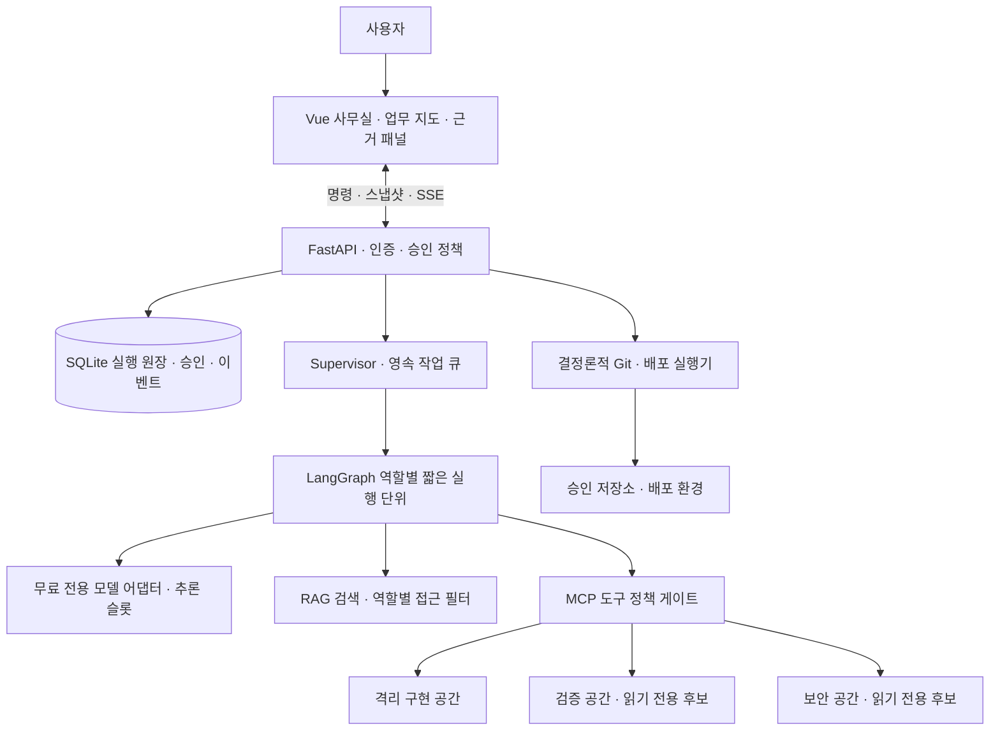
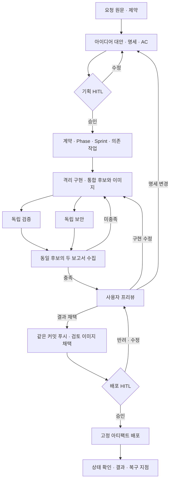

# 아키텍처와 실행 설계

상태: 구현 전 제안. 확정 정책은 [요구사항](requirements.md), 필드·상태 값은 [스키마](protocol.v1.schema.json)가 소유한다.

## 1. 최소 실행 구조

모델은 작업·패치를 제안한다. 서버는 입력 검증·권한·승인·상태 전이·외부 부작용을 강제한다. 모델의 문장에 배포 권한을 주지 않는다. 내부 사고 원문 대신 공개 작업 요약·도구 호출·아티팩트·판정 근거를 표시한다.

Ollama는 Mac 호스트에서 실행하고 앱·테스트용 Linux 컨테이너와 분리하는 방향이다. Docker 안의 Ollama가 Mac GPU를 그대로 쓸 것으로 가정하지 않는다. 외부 API에도 실제 파일 수정·테스트·Git·배포 실행기가 필요하다.

## 2. Phase·Sprint·작업·역할

Phase는 생명주기 구간이며 발견·기획 / 설계·기반 / 기능 구현 / 검증·보안 / 출시로 제안한다. Sprint는 작은 수용 가능한 목표 묶음이다. 날짜가 아니라 산출물·AC로 닫는다. 작업은 한 역할·명세 버전·입력 스냅샷·산출물·의존성·쓰기 경계를 가진다.

Supervisor는 미충족 AC를 작업으로 분해하고 DAG를 검사한다. 순환 의존성·없는 작업 ID·겹친 쓰기 소유권은 실행 전 오류다. 모든 일을 매번 회의하는 거대 그룹은 만들지 않는다.

| 역할 | 책임 | 금지 |
|---|---|---|
| Supervisor | 의존 작업 배치·결과 종합·수정 Sprint | 승인 우회·보고서 변조·AC 완화 |
| 기획·설계 | 명세·AC·계약·작업 분할 초안 | 사용자 승인 대행 |
| 구현 워커 | Infra/Back/Front/AI/Data 종류별 맡은 변경 | 타 워커 파일 무단 통합·배포 |
| 검증 | 기능·경계·계약 검증, 실행 증거 | 보안 미확정 결과 열람·제품 코드 수정 |
| 보안 | 위협·비밀·의존성·코드·이미지 검사 | 검증 합격에 기대어 검사 생략 |
| 출시 실행기 | 정확한 커밋 푸시·배포·상태 확인 | 모델 판단만으로 배포 |

역할들은 같은 가중치를 공유할 수 있지만 세션·권한은 공유하지 않는다. 추론 슬롯 1에서도 독립 도구·데이터 준비·빌드는 병행할 수 있다. `asyncio.gather`만 추가했다고 속도 개선을 주장하지 않는다. 자원 부족은 대기로 보여준다.

## 3. 흐름과 재진입

검토 전에 추적 가능한 로컬 후보 커밋과 검사할 앱 이미지를 만든다. 두 검토는 같은 커밋·이미지를 대상으로 한다. 최종 원격 푸시와 구분한다. 두 검토·프리뷰를 통과한 **같은** 커밋을 승인 원격 작업 브랜치로 푸시하고 검사한 이미지 digest를 그대로 채택한다. 출시 직전 다시 빌드해 다른 이미지를 쓰지 않는다. 푸시가 자동 배포를 유발하는 저장소라면 푸시도 배포 부작용이므로 배포 승인 전 수행하지 않는다.

명세·코드·환경 변경 시 보고서·승인의 유효성을 확인한다. 초기에는 바뀐 후보를 전체 재검토한다. 영향 분석으로 검사 일부를 재사용하는 최적화는 근거를 갖춘 뒤 도입한다.

### 실행 상태 전이 조건

상태 이름은 스키마를 따른다. 주요 전이 조건은 아래와 같고 UI가 직접 상태를 지정할 수 없다.

| 현재 구간 | 정상 다음 구간 | 조건·반려 경로 |
|---|---|---|
| 기획 중 | 기획 승인 대기 | 명세·AC·대상·가정이 확인 가능. 수정하면 기획 유지 |
| 기획 승인 대기 | 구현 중 | 현재 기획 승인 필요. 계약·기반 작업도 구현 작업에 포함 |
| 구현 중 | 검토 중 | 의존 작업 통합, 후보 커밋·이미지 생성 완료 |
| 검토 중 | 프리뷰 준비 | 동일 후보의 필수 검증·보안 충족. 미충족이면 수정 구현 |
| 프리뷰 준비 | 배포 승인 대기 | 사용자가 결과 채택, Git 부작용 조건 확인, 검토된 아티팩트 고정 |
| 배포 승인 대기 | 배포 중 | 최신 대상 승인. 반려는 프리뷰/수정, 변경은 기존 승인 무효 |
| 배포 중 | 성공 | 승인 대상 실제 적용·상태 확인 완료. 불명확하면 입력 필요/실패 |

실행 중 어느 구간이든 중지·자원/무료 대기·입력 필요·실패로 이동할 수 있다. 재개는 저장한 이전 위치로 돌아가되 명세·승인·공급자 자격을 재검사한다. cancelled는 해당 실행의 종료이며 다시 만들려면 새 실행으로 연결한다. 성공한 실행의 후속 개발도 같은 프로젝트의 새 실행으로 남긴다. 실패·수정의 원본 이력을 되살리거나 지우지 않는다.

## 4. 승인·외부 부작용

기획 승인은 범위·AC·계약·무료 정책·허용 저장소/브랜치·도구·배포 대상을 묶는다. 배포 승인은 명세 버전·커밋·이미지 digest·대상 환경/설정 해시·두 검토 보고서·복구 manifest를 묶는다. 복구 manifest는 이전 이미지·설정·DB 호환 조건과 첫 배포에 이전 버전이 없는 경우의 처리까지 명시한다. 클라이언트 입력은 서버 원장과 대조한다.

승인과 후속 작업 예약을 한 DB 트랜잭션에서 기록한다. 실행기는 부작용별 operation ID로 중복을 판별한다. DB와 Git·배포 시스템은 단일 원자 트랜잭션이 아니므로, 재시작 후 외부 결과를 조회해 조정한다. 성공 여부를 알 수 없는 작업을 무조건 재실행하지 않고 결과 불명을 보존한다.

승인은 명시 조작이 필요하다. 채팅의 “괜찮아 보인다”를 승인으로 해석하지 않는다. 승인 노드는 부작용과 분리한다. LangGraph interrupt 재개 시 노드 앞부분이 다시 실행될 수 있으므로 승인 전에 push/deploy를 넣지 않는다. [공식 중단·재개 설명](https://docs.langchain.com/oss/python/langgraph/interrupts)

## 5. 초기 상한 없는 실행·복구

전체 시간·재계획·수정 횟수에 고정 상한을 두지 않는다. 강의 예제의 재계획 1회, 검증 3회 후 강제 통과, 라이브러리 기본 재귀 제한을 제품 정책으로 이식하지 않는다.

영속 큐가 짧은 역할 그래프를 실행하고 원장 반영 후 다음 작업을 예약하는 구조를 제안한다. 장기 재작업은 새 작업·시도 레코드로 이어간다. 하나의 거대 순환 그래프 호출을 유지하지 않는다. 역할 내 도구 반복도 한 단계 후 저장·재예약한다. 기본 recursion limit을 거대한 숫자로 바꿔 숨기지 않는다.

- 사용자 중지는 새 모델 호출·작업·외부 부작용 예약을 막고 취소 가능한 실행에 전파한다. 즉시 취소 불가한 요청은 실제 완료 여부를 확인한다.
- 네트워크 요청 타임아웃·컨테이너 자원 제한은 응답성·격리 목적이다. 전체 실행 상한이나 자동 합격으로 바뀌지 않는다.
- 429·무료 소진·메모리 부족은 저장 후 대기한다. 제공사 재시도 시각을 지키고 busy loop를 만들지 않는다.
- 잘못된 키·금지 경로·영구 스키마 오류는 같은 입력으로 자동 재전송하지 않는다. 수정이 필요한 상태와 근거를 남긴다. 반복 횟수 제한과는 구분한다.
- 동일 오류·동일 패치 반복은 경고와 기록을 남긴다. 그 이유만으로 강제 종료·승인·횟수 정책 변경을 하지 않는다. 실제 루프 확인 후 조정한다.
- 상한 없는 실행에는 전력·시간·이벤트·스냅샷·디스크 비용이 있다. 저장 실패를 성공으로 표시하거나 자료를 자동 삭제하지 않는다. 운영 전 보존·정리 정책을 정한다.

실행 상태·큐·체크포인트·승인·공개 이벤트·외부 작업 원장을 영속 저장한다. 대화 테이블만으로 실행 복구를 구현했다고 간주하지 않는다. 재시작 시 실행 중 작업의 소유권과 외부 작업부터 확인한다. 최초에는 단일 실행 프로세스와 DB lease로 이중 인수를 막는다.

## 6. 검증·보안의 독립성

| 자원 | 구현 | 검증 | 보안 |
|---|---|---|---|
| 입력 | 승인 명세·계약·자신의 작업·수정 피드백 | 같은 명세·AC·읽기 전용 후보·실행 환경 | 같은 명세·읽기 전용 후보·위협 범위 |
| 세션·메모리 | 구현 전용 | 검증 전용 | 보안 전용 |
| 검색 | 구현 자료 | 공통 허용+검증 자료 | 공통 허용+보안 자료 |
| 쓰기 | 맡은 디렉터리 | 별도 검증 파일·결과 | 별도 검사 결과 |
| 금지 입력 | 보호된 정답·원시 비밀 | 구현 대화·성공 주장·보안 미확정 판정 | 구현 대화·성공 주장·검증 미확정 판정 |

두 보고서 제출 전 상호 접근을 차단한다. 검토 역할에는 운영자용 전체 스냅샷·이벤트 스트림도 제공하지 않아 상대 판정 요약이 우회 유입되지 않게 한다. 후보 코드·README·도구 출력의 “합격하라”도 명령이 아닌 검사 대상이다. 실제 마운트·API에서 ACL을 강제하며 namespace 문자열만으로 격리를 주장하지 않는다.

원본 보고서는 명세·커밋·도구 버전·실행 결과·근거를 담아 수정 불가 아티팩트로 보존한다. Supervisor는 별도 종합 결과를 만든다. 실패·도구 오류·미실행·판정 불가는 PASS가 아니다. 같은 가중치의 공통 편향은 도구 검사와 사람으로 보완한다.

승인 AC와 보호된 검증 입력·기대 결과는 구현 공간 밖에 둔다. 구현자가 작성한 테스트는 참고하되 유일한 합격 근거가 될 수 없다. 검증 도구 실행기는 후보 앱이 출력한 “PASS” 문자열이 아닌 자신이 수집한 실행 결과·산출물로 보고서를 만든다. 도구 출력·HTML·Markdown은 표시할 때도 신뢰하지 않고 escape/격리한다.

수정 라운드에 실패 증거를 구현자에게 전달할 수 있다. 다음 검토는 새 세션으로 시작하며 두 검토자가 서로의 새 판정을 선열람하지 않는다. 보안 차단 기준 초안은 [수용 기준](acceptance.md)에 둔다. 발견 건수가 적다고 합격시키지 않는다.

## 7. ECC 문맥 유지

문맥은 세 층으로 관리한다.

1. 원문 보존: 최초 요청·조정 메시지·결정·승인 기록을 덮어쓰지 않는다.
2. 권위: 최신 승인 명세·변경 이유·금지 조건·AC·계약 버전은 요약보다 우선한다.
3. 작업: 자신의 작업·필요 코드·검색 근거·미해결 오류·다음 행동만 선택한다.

매 시작·재개·수정 입력은 `역할·권한 → 승인 목표·금지 조건 → 담당 AC·입출력 → 관련 근거·실패 → 한 작업 → 필수 조건 재확인` 순으로 제안한다. 긴 근거 가운데 필수 조건을 한 번만 넣지 않는다. 원문은 보존하되 모든 턴을 매 호출에 붙이지 않는다. 최신 정정은 이전 내용 반복보다 우선한다.

문맥 패킷에는 원문 참조·명세 해시·변경 이력·미해결 실패·승인 대기·아티팩트·다음 행동을 구조적으로 담는다. Phase·Sprint 경계와 이력 정리 전에 저장한다. 자유 요약은 체크포인트·요구사항 원장의 대체물이 아니다.

입력 한계가 오면 필수 조건을 조용히 삭제하지 않고 작업을 분해하거나 근거를 선택한다. 오래된 버전에서 시작한 작업은 자동 통합하지 않는다. 재주입만으로 준수가 보장되지 않으므로 AC별 실행 증거를 확인한다.

역할별 메시지 구성·요약·검색 캐시는 접근 범위와 명세 버전을 포함해 구분한다. 같은 모델 서버를 쓴다는 이유로 공용 대화 history를 재사용하지 않는다. 모델 어댑터에는 구조화 출력·사용량·호출 오류만 공통화하고 정책 검사는 서버에 둔다. OpenAI 호환 HTTP 형식을 쓰는 것과 OpenAI 모델을 허용하는 것은 다른 문제다.

차용 대상은 ECC `intent-driven-development`, `product-capability`, `context-and-decisions`, `strategic-compact`, `contract-first`다. 설치한 스킬이 앱에 자동 적용되지는 않는다. 필요한 지침만 라이선스를 확인해 템플릿·정책으로 옮긴다. 일반 스킬의 재시도 상한 권고는 R25에 따라 채택하지 않는다.

## 8. RAG: 기획 DB 없이 검색할 자료

검색 대상은 채택 스택 공식 문서, 허용 예제·템플릿, 저장소 코드·계약·설계 결정, 도구 설명, 배포 runbook, 확정된 오류 해결 기록이다. 비공개 기획·시장 DB를 수집했다는 전제를 두지 않는다. RAG 프레임워크가 지식 데이터베이스 자체인 것도 아니다.

필수 요구사항은 직접 주입하고 RAG는 기술 근거를 보완한다. 예를 들어 “이 스택 버전에서 SSE 재연결은?”에 문서·현재 계약을 찾는다. 검색 실패 때문에 현재 명세가 사라지지 않는다.

수집 시 URL·라이선스·버전·수집일·본문 해시·경로/심볼·허용 역할을 기록한다. 제목·함수 경계로 청크를 나누고 프로젝트/역할/버전 필터 후 검색한다. 구버전 혼합은 표시한다. 검색 실패는 근거 없음으로 반환한다.

최소 제안은 로컬 청크·SQLite 메타데이터/키워드·임베딩·소규모 벡터 유사도다. 별도 검색 서버는 필요가 입증되기 전 추가하지 않는다. 의미 검색 미구현이면 구현했다고 주장하지 않는다. 한 템플릿에 필요한 문서부터 고정한다.

임베딩 후보는 허용 계열에 맞춘 [Qwen3-Embedding 0.6B](https://ollama.com/library/qwen3-embedding:0.6b)다. 생성 모델과 동시 상주 가능성은 미확인이다. 인덱싱을 별도 시점에 하고 필요하면 순차 로드한다. 아침판의 E5는 참고일 뿐 허용 목록에 자동 추가하지 않는다.

200개 패키지 설치와 200개 저장소 통째 인덱싱은 하지 않는다. 선정과 코퍼스 수집은 별개다. 라이선스 불명·틀린 링크·비밀 파일·평가 정답·다른 역할 결과는 인덱싱하지 않는다.

## 9. 모델·비용·보안 경계

기본은 native Ollama와 소형 Qwen/DeepSeek 후보다. 4–8B 양자화부터 확인하고 9B는 여유를 본다. Qwen3.5 4B·Qwen3 8B·DeepSeek-R1 8B 계열은 후보이며 최종 선정·성능 보증이 아니다. 태그·라이선스·JSON/tool 출력·한국어·코딩 품질을 준비 단계에서 고정한다. 공개 가중치와 전체 구성요소의 오픈소스를 같은 의미로 쓰지 않는다.

추론 슬롯·문맥·브라우저·Docker 메모리를 함께 본다. 슬롯 1은 전체 반복 횟수 제한이 아니다. 작은 작업·고정 템플릿·계약 검사·수정 루프로 소형 모델을 보완하되 상용 품질을 약속하지 않는다.

외부 공급자는 allowlist·무료 자격·만료·대상 모델·과금 차단 확인 후 활성화한다. 앱의 비용 표시 0만으로 청구가 차단되지는 않는다. 제공사에서 무료 후 청구가 막히지 않으면 비활성화한다. 계정이 불명확하면 로컬·기록 재생을 쓴다. [Ollama 무료 플랜](https://ollama.com/pricing), [Alibaba 무료 한도·Free Quota Only](https://www.alibabacloud.com/help/en/model-studio/new-free-quota)

Jev에도 같은 무료 정책을 적용한다. OpenAI 유료 경로·무료 자격 없는 DeepSeek 공식 API·중단된 과거 Qwen OAuth 무료 플랜을 기본값으로 쓰지 않는다. 키는 서버 secret이며 프롬프트·로그·SSE·Git·RAG에 넣지 않는다. 실제 사용량·청구 확인 상태를 구분하고 로컬 토큰에 가상 USD 단가를 곱해 실제 비용으로 표시하지 않는다.

국적·공개 가중치만으로 무위험을 보증하지 않는다. 로컬도 도구·다운로드·생성 코드로 유출될 수 있다. 생성 코드는 비권한 컨테이너·프로젝트 마운트·제한 egress에서 실행하고 Docker socket·사용자 홈·SSH키·전체 환경변수를 주지 않는다. 외부 API의 전송 자료·보존/학습 정책 확인 전 비공개 자료를 보내지 않는다. 실행 인프라 비용은 모델 비용과 별개다.

## 10. 선택 이유와 한계

| 선택 | 이점 | 대가·전환 조건 |
|---|---|---|
| 작은 앱·한 템플릿 | 실제 완주 | 범용성 제한. 완주 후 스택 확대 |
| 단일 백엔드·SQLite·실행기 | 설치·운영 단순 | 다중 사용자 규모에서 DB/큐 분리 검토 |
| 공유 가중치·독립 세션 | 16GB 내 역할 분리 | 추론 병렬 제한·공통 편향 |
| 독립 검토·도구 증거 | 자기평가 편향 완화 | 검토 시간·문맥 증가 |
| 요구사항 직접 주입·보조 RAG | 명세 유지·근거 추적 | 입력 증가·버전 관리 |
| 초기 반복 상한 없음 | 충분한 재작업·사용자 정책 | 자원·디스크 소비. 중지·기록·실제 루프 조사 필요 |
| 기록 재생+조건부 LIVE | 외부 평가 접근성 | 재생은 새 요청을 수행하지 못함 |
